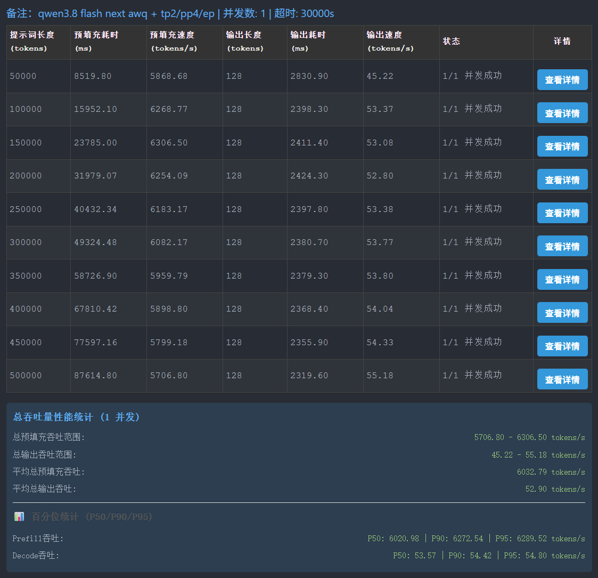
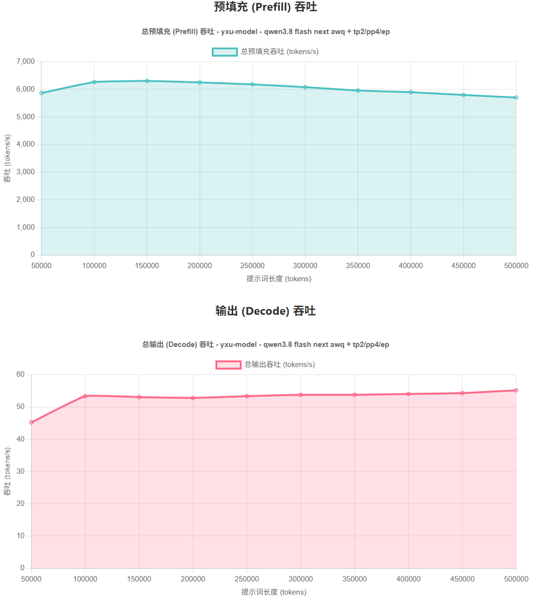
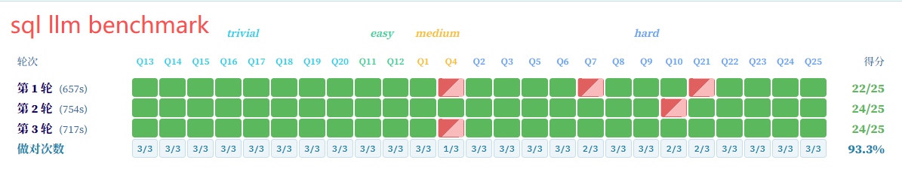

# vLLM SM75 Fork — Qwen3.8-Flash-Next on 8× RTX 2080 Ti 22G

本分支让 Qwen3.8-Flash-Next（AWQ / NVFP4 / FP8）在 **8× RTX 2080 Ti 22G（Turing sm75，无原生 FP8/BF16，无 NVLink）**
上跑起来，并针对 prefill/decode 做了 SM75 专项优化与稳定性修复。

- 基线：上游 `main @7f1a5398e`（2026-09-24，约 `v0.30.1rc0+60`），分支 `sm75-flashnext-awq`。
- 目标拓扑：**TP2×PP4 + EP**（同 PCIe 岛内 TP，跨岛 PP）。
- License：Apache-2.0（同上游）。

## 测试环境

- 主机：超微（Supermicro）**4028GR**
- CPU：Intel Xeon **E5-2673 v4 ×2**
- 内存：**128 GB**
- GPU：**8× RTX 2080 Ti 22G（魔改）**，无 NVLink
- 系统：**Ubuntu 24.04 LTS**
- 驱动：**魔改驱动，开通 PCIe P2P**（GeForce 无 NVLink，靠 NVIDIA open 内核模块开 P2P；见"稳定性备忘"）

## 主要改动

| 改动 | 文件 / 开关 | 说明 |
|---|---|---|
| QSA prefill `BLOCK_N=16` | `vllm/models/qwen4_exp/nvidia/ops/qsa.py`，`VLLM_QWEN4_QSA_PREFILL_BN` | 32 KiB smem、每 SM 双 block；实测 25K prefill −9%、110K −12%，PPL 中性 |
| PLE mmap overlay | `vllm/vllm_ple_mmap.py`，`VLLM_PLE_MMAP_MODE=mem` + `VLLM_PLE_MEM_LAZY=1` + `VLLM_PLE_HOST_GATHER=1` | 95.4 GiB ngram 表驻 `/dev/shm`，后台填充、未填片回磁盘；gather 移出 forward，decode 可用 FULL 图 |
| QSA indexer / Turing autotune | `VLLM_QWEN4_TURING_AUTOTUNE=1`，`VLLM_QWEN4_INDEXER_CUBLAS` | cuBLAS 大 prefill 打分（密集形状约 2.6x；已做数值对照：与 Triton 最大差 4.6e-05，top-k 零翻转，默认 `0` 最稳） |
| Turing GEMV（实验性） | `vllm/turing_gemv.py` + `linear.py`，`VLLM_TURING_GEMV=1` | M=1 fp16 dense 的 Triton streaming GEMV；**未充分验证，稳定性测试建议先关** |
| **AR 256 KiB 安全门（稳定性关键）** | `custom_all_reduce.py`（`VLLM_SM75_CUSTOM_AR_MAX_BYTES`，默认 262144）+ `flashinfer_pcie_ipc_all_reduce.py`（`VLLM_SM75_FI_PCIE_IPC_MAX_BYTES`） | custom AR / FlashInfer PCIe-IPC 单发超 256 KiB 会挂 GSP（Xid 119）；超限自动回退 NCCL，小包（decode）继续走高速路径 |
| FlashInfer PCIe-IPC 回填 | 需配合 venv 中 flashinfer 0.7.0 回填；`VLLM_ALLREDUCE_USE_FLASHINFER_PCIE_IPC=1` | TP4 上 decode +17%、prefill 中性（TP2 走 custom AR/NCCL，此项无收益） |

## 支持的量化格式（sm75，weight-only）

Turing（sm75）**没有原生 FP8 / FP4 / BF16 计算单元**，所以本栈里所有量化格式都走 **weight-only**：
权重按量化格式解码，**激活/累加用 fp16**（Tensor Core HMMA），dense 与 MoE 分别落到对应的 Marlin 内核。

| checkpoint 格式 | `quantization` | sm75 后端 | 权重 / 激活 | 日志标志 |
|---|---|---|---|---|
| AWQ INT4（W4A16，group=32/128） | `awq` / `compressed-tensors`（pack-quantized） | `Marlin` WNA16 | 4bit / fp16 | `Using 'MARLIN' ... WNA16 MoE backend` |
| AutoRound INT4（W4A16） | `compressed-tensors` | `Marlin` WNA16 | 4bit / fp16 | 同上 |
| NVFP4（W4A16_NVFP4，modelopt） | `modelopt` / `compressed-tensors` | `Marlin` **NvFp4** | FP4 / fp16 | `Using 'MARLIN' NvFp4 MoE backend` |
| FP8（blockwise，`weight_block_size=[128,128]`） | `fp8` | `MARLIN` Fp8（W8A16） | FP8 / fp16 | `Using MARLIN Fp8 MoE backend` + `marlin_utils_fp8.py:236 Weight-only FP8 ... leveraging the Marlin kernel` |

统一要求：
- **`--dtype float16`**：sm75 无 bf16 原生，checkpoint 里的 bf16 权重会被 cast（日志 `Casting torch.bfloat16 to torch.float16`）。
- `--gdn-prefill-backend flashqla_sm75`、`--kv-cache-dtype auto`（或 `fp16`）。
- FP8 额外：`--language-model-only`（省视觉路径）、`--max-num-seqs ≤ 93`（默认 256 会超可用 Mamba cache 块，见下）。

### 回退到 fp16 运行的方式

1. **自动回退（weight-only → fp16 计算）**：上面三种格式在 sm75 上都**自动**回退为"解码权重 + fp16 GEMM"，**无需开关**；启动日志出现 `Using 'MARLIN' ... MoE backend`（或 `Weight-only FP8 ... Marlin kernel`）即表示已走此路径。
2. **手动跑全 fp16（未量化）**：量化路径不稳定、或想做精度上限对照时，用**未量化的 bf16 checkpoint** + `--dtype float16`，把权重 cast 成 fp16：
   ```bash
   vllm serve <bf16-model> --dtype float16   # 其余参数同下方快速启动
   ```
   注意：fp16 权重显存约为 INT4 的 ~4×，8×22G 可能放不下大模型；可配合 `--max-model-len` 缩小、`--gpu-memory-utilization` 调整，或 `--cpu-offload-gb N` 把部分权重放宿主内存。
3. **与 AR 无关**：量化格式不影响集合通信；若遇到 GSP/MMU 崩溃，加 `--disable-custom-all-reduce`（保留 PCIe P2P，只换掉自旋式 custom AR）即可，量化格式照常。

## 快速启动（AWQ，TP2PP4）

```bash
# 前置：venv 的 vllm 在 PATH 中，且已清 /dev/shm 残留
export PATH="/home/yxu/llm/venvs/vllm/bin:/usr/local/cuda/bin:$PATH"
rm -f /dev/shm/ple_mmap_* /dev/shm/psm_*

VLLM_PLE_MMAP_MODE=mem VLLM_PLE_MEM_LAZY=1 VLLM_DEFER_ENGRAM_LOAD=0 \
        VLLM_DROP_CHECKPOINT_CACHE=0 VLLM_PLE_HOST_GATHER=1 \
        VLLM_USE_BREAKABLE_CUDAGRAPH=1 VLLM_QWEN4_TURING_AUTOTUNE=1 \
        TRITON_PRINT_AUTOTUNING=0 VLLM_QWEN4_QSA_PREFILL_BN=16 \
        VLLM_QWEN4_INDEXER_CUBLAS=1 VLLM_SPARSE_INDEXER_MAX_LOGITS_MB=64 \
        VLLM_TURING_GEMV=1 VLLM_ALLOW_LONG_MAX_MODEL_LEN=1 \
        VLLM_ALLREDUCE_USE_FLASHINFER_PCIE_IPC=1 \
        CUDA_VISIBLE_DEVICES=0,1,2,3,4,5,6,7 \
        vllm serve models/qwen3.8-flash-next-awq \
        --tensor-parallel-size 2 --pipeline-parallel-size 4 --enable-expert-parallel \
        --dtype float16 --kv-cache-dtype auto \
        --gpu-memory-utilization 0.92 --max-model-len 524288 --max-num-seqs 4 --enable-prefix-caching \
        --max-num-batched-tokens 4096 --trust-remote-code \
        --gdn-prefill-backend flashqla_sm75 \
        --compilation-config '{"cudagraph_mode": "FULL_AND_PIECEWISE"}' \
        --enable-auto-tool-choice --tool-call-parser qwen3_coder --reasoning-parser qwen3 \
        --hf-overrides '{"text_config": {"rope_parameters": {"mrope_interleaved": true, "mrope_section": [11, 11, 10], "rope_type": "yarn", "rope_theta": 10000000, "partial_rotary_factor": 0.25, "factor": 2.0, "original_max_position_embeddings": 262144}}}' \
        --port 32768 --host 0.0.0.0
```

要点：
- 起服前确认 8 卡显存为 0（残留 `VLLM::Worker` 会占卡，用 `pkill -9 -f 'VLLM::Worker'` 清）。
- FP8 模型另需 `--max-num-seqs 64`（默认 256 会超 Mamba cache）与 `--language-model-only`。
- 6 并发以上建议保持 `--disable-custom-all-reduce`（NCCL）直到 AR 路径 soak 通过；本分支默认已把 custom AR 钳在 256 KiB，日志出现
  `SM75: capping custom allreduce max_size 8388608 -> 262144 bytes` 即生效。

## 稳定性备忘（2080Ti 魔改卡 + open 内核）

- 本机必须用 **NVIDIA open 内核模块**（GeForce 开 PCIe P2P 需要它），代价是 GSP 关不掉。
- custom AR / FlashInfer PCIe-IPC / PLX two-stage 的**大包（>256 KiB）P2P 猛冲会挂 GSP（Xid 119，游走）**；NCCL 的 P2P 正常。本分支用 256 KiB 门限隔离。
- 另见过 **Xid 32（MMU 非法访存）→ UVM fatal → 整机需 reboot**；与 custom AR 开启强相关，生产环境先用 NCCL。
- 平台不支持 PCIe AER；`watch nvidia-smi` 这类高频全量 NVML 轮询会加剧 GSP 压力，服务时别开（要用就用 `--loop-ms` 单进程低频）。
- GPU 功耗上限可按需设置（本速度测试为 250W；长时间稳定运行可酌情下调）；温度正常（40~50°C）。

## 性能基线（AWQ，TP2PP4，8×2080Ti 22G）

- 25K prefill ≈ 4.7s，110K ≈ 18s；decode ≈ 51 tok/s；PPL ≈ 10.74。
- QSA BN16：prefill −9%（25K）/ −12%（110K），精度中性。
- 精度：自建栈 + Flash-Next AWQ 与 ModelScope 官方 API 跑分基本持平（549 vs 549，6 项工具基准：ToolCall/InstructFollow/PromptAuthority/ReasonMath/BugFind/StructOutput）。

## 速度基准（Prefill / Decode）

模型：Qwen3.8-Flash-Next AWQ + TP2/PP4/EP，**并发 1**，输出固定 128 tokens，上下文 50K–500K，**GPU 功耗上限 250W**。

| 提示长度 (tokens) | Prefill (tokens/s) | Decode (tokens/s) |
|---|---|---|
| 50,000 | 5868.68 | 45.22 |
| 100,000 | 6268.77 | 53.37 |
| 150,000 | **6306.50** | 53.08 |
| 200,000 | 6254.09 | 52.80 |
| 250,000 | 6183.17 | 53.38 |
| 300,000 | 6082.17 | 53.77 |
| 350,000 | 5959.79 | 53.80 |
| 400,000 | 5898.80 | 54.04 |
| 450,000 | 5799.18 | 54.33 |
| 500,000 | 5706.80 | **55.18** |

- **Prefill**：平均 **6032.79 tok/s**（P50 6020.98 / P90 6272.54 / P95 6289.52），峰值 ~6306 @150K；满 500K 上下文约 **87.6s**。
- **Decode**：平均 **52.90 tok/s**（P50 53.57 / P90 54.42 / P95 54.80）。





## SQL 本地基准（Qwen3.8-Flash-Next AWQ）

25 道 SQL 题（trivial / easy / medium / hard），跑 3 轮：

| 轮次 | 得分 | 耗时 |
|---|---|---|
| 第 1 轮 | 22/25 | 657s |
| 第 2 轮 | 24/25 | 754s |
| 第 3 轮 | 24/25 | 717s |
| **合计** | **70/75 = 93.3%** | — |

- trivial 10 题全对；错题集中在 **easy 的 Q1**、**hard 的 Q8 / Q10 / Q21**。
- 每题 3 轮做对次数：Q1 = 1/3（不稳），Q8 / Q10 / Q21 各 = 2/3，其余全 3/3。


